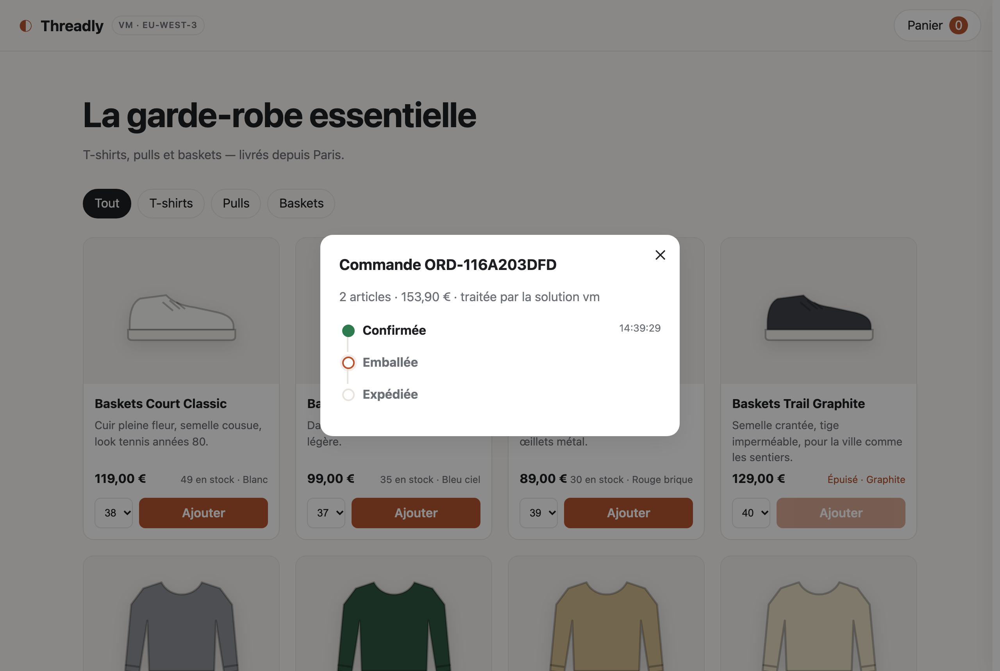
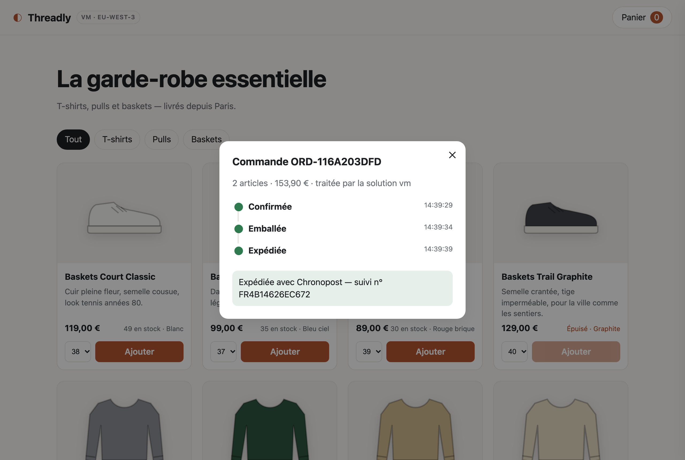
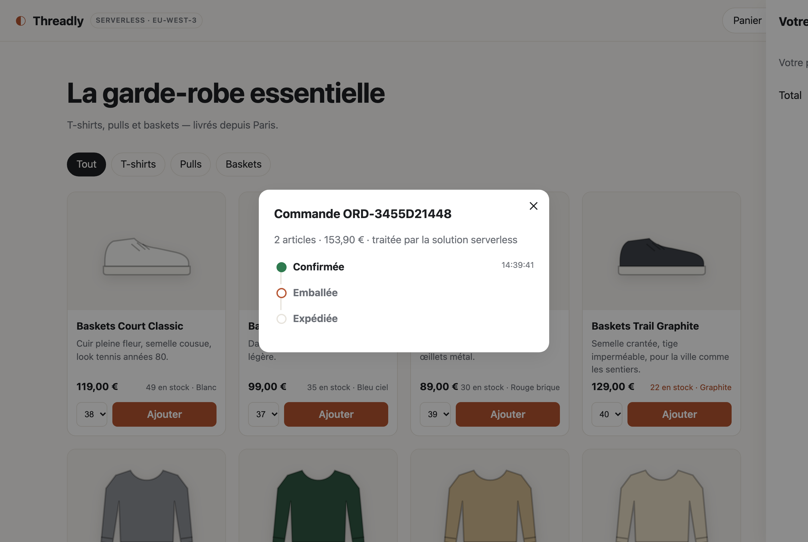
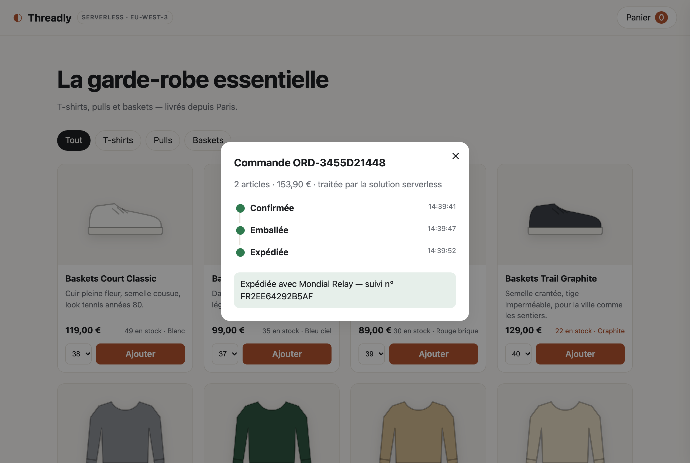
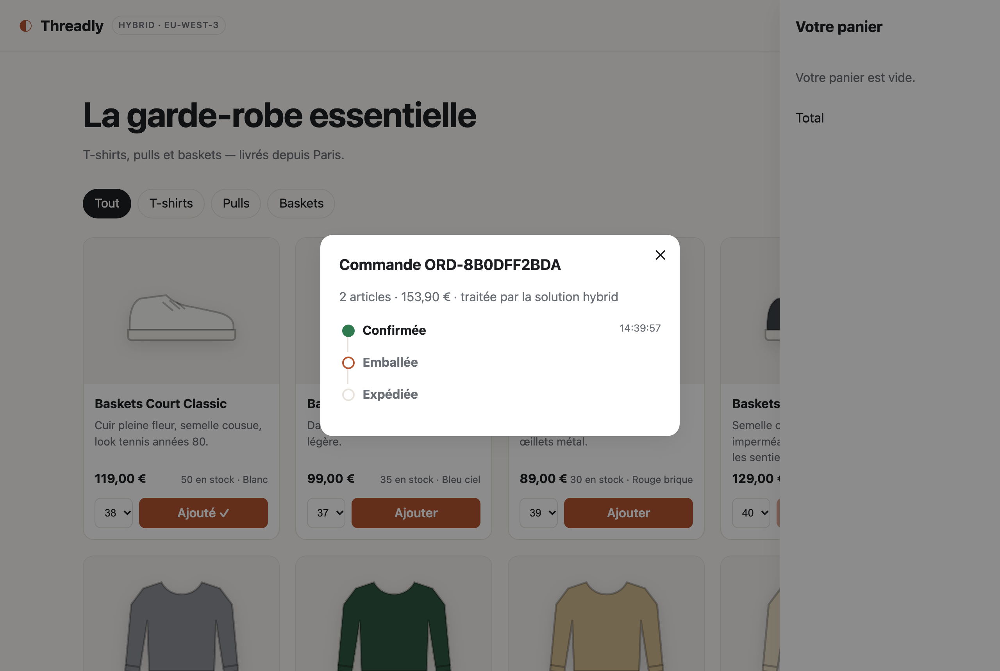
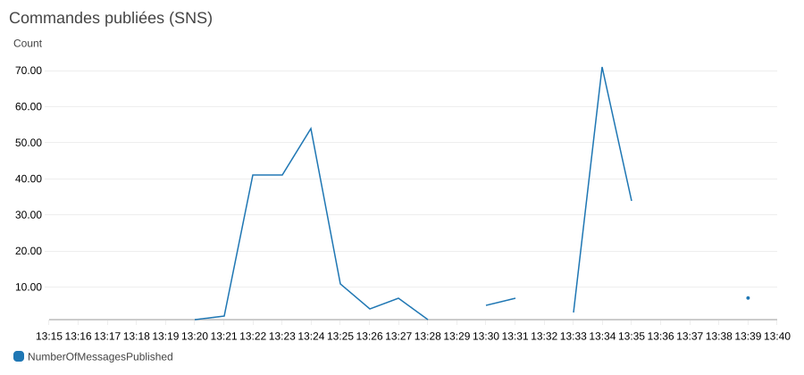
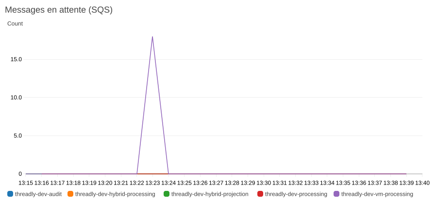
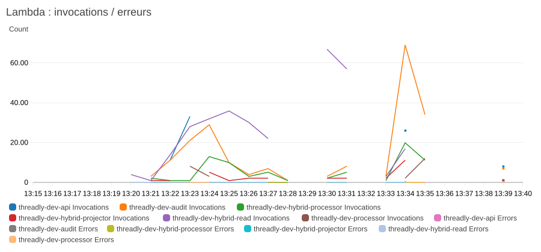
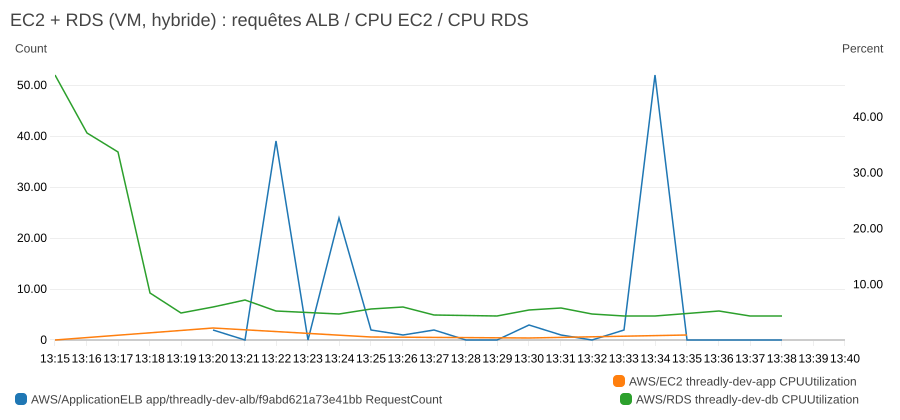

# Threadly — boutique en ligne sur AWS

*Projet AWS FISA 2026, Infrastructures cloud et virtualisation. Rapport (§4.2 du sujet), octobre 2026.*

## 1. Contexte et exigences

Threadly est une boutique de vêtements fictive : t-shirts, pulls et baskets. Les clients
consultent un catalogue, commandent un ou plusieurs produits et suivent leur commande en
temps réel. En interne, chaque commande est archivée pour l'audit, puis elle passe par une
préparation simulée : emballage, puis expédition avec un transporteur et un numéro de suivi.

Le projet comprend **trois solutions** :

1. une solution **serverless** ;
2. une solution à base de **machines virtuelles** (EC2) ;
3. une solution **hybride**, qui place chaque partie de la boutique sur le service qui lui
   convient le mieux : fichiers statiques sur S3, lectures sur Lambda + DynamoDB,
   commandes sur EC2 + RDS, traitement sur Lambda.

Toutes sont hautement disponibles, décrites en Terraform et adaptées au Free Tier pour
garder un coût nul. Elles sont **déployées ensemble** avec un seul `terraform apply`.
Elles servent le même front et partagent le bus d'événements et l'audit, ce qui permet de
les comparer directement (§2.5).

| Exigence du sujet | Solution serverless | Solution VM | Solution hybride |
|---|---|---|---|
| Parcourir le catalogue via une interface web | CloudFront + S3 (site statique, OAC) ; API : Lambda `api` (Function URL) + DynamoDB | CloudFront → ALB → EC2 (site + API Python) → RDS PostgreSQL | CloudFront + S3 (site, OAC) ; catalogue : Lambda `hybrid-read` + DynamoDB |
| Commander un ou plusieurs produits | Transaction DynamoDB (`TransactWriteItems`) : stock et commande en une opération atomique | Transaction PostgreSQL avec `SELECT … FOR UPDATE` | CloudFront → ALB → EC2 → transaction PostgreSQL (`SELECT … FOR UPDATE`) |
| Message de confirmation | SNS `order-events` → abonnement e-mail (`ORDER_CREATED`, `ORDER_SHIPPED`) ; suivi en direct dans le front | identique | identique ; suivi servi par la Lambda `hybrid-read` |
| Enregistrer toutes les commandes (audit, reporting) | SNS → SQS `audit` → Lambda `audit` → S3, partitionné `event_type=…/date=…` (lisible par Athena) | identique (bus commun) | identique (bus commun) |
| Traitement interne (emballage, expédition) | SNS → SQS `processing` (délai 5 s) → Lambda `processor` | SNS → SQS `vm-processing` (délai 5 s) → worker sur les EC2 | SNS → SQS `hybrid-processing` (délai 5 s) → Lambda `hybrid-processor` |
| Serverless **et** Compute EC2 | Lambda, DynamoDB, S3, SNS, SQS | VPC, ALB, Auto Scaling Group EC2, RDS | les deux : Lambda et DynamoDB pour lire, EC2 et RDS pour écrire |
| Événementiel (SNS), streaming si possible (Kafka/MSK) | SNS + SQS avec politiques de filtrage | SNS + SQS ; MSK prévu en option (`enable_msk`) | SNS + SQS ; projection CQRS des événements dans DynamoDB |
| Terraform | tout dans `infra/`, `up.sh` / `down.sh` | idem | idem (`hybrid.tf` et ressources partagées) |
| Haute disponibilité | services managés multi-AZ | ALB et ASG sur 2 AZ, CloudFront | lectures multi-AZ, commandes sur 2 AZ |
| Coût nul (Free Tier) | voir §3 | voir §3 | voir §3 |

## 2. Les trois architectures

### 2.1 Solution 1 : serverless


- **CloudFront** est la seule porte d'entrée. `/*` est servi depuis le bucket S3 privé via
  *Origin Access Control*. `/api/*` est transmis à la **Function URL** de la Lambda `api`,
  avec un en-tête secret `X-Origin-Verify` que la Lambda vérifie. Appeler la Function URL
  directement renvoie donc 403.
- **Lambda `api`** (Python 3.12, 256 Mo) lit le catalogue et crée les commandes dans
  **DynamoDB**. La création est une transaction : décrément conditionnel du stock de chaque
  ligne (`stock >= quantité`) et écriture de la commande. Si une seule ligne échoue, rien
  n'est écrit, et l'API renvoie 409.
- La Lambda publie `ORDER_CREATED` sur **SNS**. Une politique de filtrage
  (`source = serverless`) envoie l'événement dans la file **SQS `processing`**, dont le délai
  de 5 s simule le temps d'emballage. La Lambda **`processor`** fait passer la commande à
  `PACKED`, puis publie `ORDER_PACKED`, qui revient dans la même file et produit `SHIPPED`.
- Pourquoi ces services : ils ne coûtent rien au repos, montent en charge sans
  configuration, sont répartis sur plusieurs AZ par AWS, et leur Free Tier est permanent
  (Lambda, DynamoDB, SNS, SQS).

### 2.2 Solution 2 : machines virtuelles


- **VPC** `10.20.0.0/16` sur 2 AZ : sous-réseaux publics pour l'ALB et les EC2,
  sous-réseaux privés pour RDS. Des endpoints *gateway* S3 et DynamoDB (gratuits) gardent
  ce trafic dans le réseau AWS.
- **ALB** sur 2 AZ, limité par son security group à la *prefix list* CloudFront. Une règle
  d'écoute exige l'en-tête `X-Origin-Verify` ; sans lui, la réponse est 403.
- **Auto Scaling Group** de 1 à 2 `t3.micro`, réparties sur 2 AZ, avec un *target
  tracking* à 60 % de CPU et le health check de l'ALB. Chaque instance démarre avec un
  *user data* qui télécharge l'application depuis S3 et lance un service systemd. Ce
  service sert le site et l'API, et fait aussi tourner un worker qui lit la file SQS
  `vm-processing` en *long polling*.
- **RDS PostgreSQL 16** (`db.t3.micro`, 20 Go, chiffré, non public). Son mot de passe est
  généré par Terraform et stocké dans **SSM Parameter Store** (SecureString) ; les
  instances le lisent au démarrage.
- Pourquoi ces services : c'est l'architecture « classique » à trois tiers. Elle montre
  tout ce que la solution serverless masque : réseau, répartition de charge, montée en
  charge, base relationnelle.

### 2.3 Solution 3 : hybride


**Idée :** les solutions serverless et VM traitent toutes les parties de la boutique de la
même façon. Or ces parties n'ont pas les mêmes besoins. La solution hybride place chacune
sur le service qui lui convient, derrière **une seule distribution CloudFront qui route par
chemin** (`infra/hybrid.tf`) :

| Chemin | Destination | Pourquoi cette partie est placée là |
|---|---|---|
| `/*` (front) | **S3** + CloudFront, même bucket et même OAC que la solution serverless | Des fichiers statiques : rien à calculer, aucun serveur à faire tourner. |
| `/api/products*`, `/api/orders/{id}` (catalogue, suivi) | **Lambda `hybrid-read` + DynamoDB** | Les lectures sont les requêtes les plus nombreuses et les plus simples : une clé, une réponse. Lambda et DynamoDB les servent sans serveur, à coût nul au repos. |
| `POST /api/orders` (commande) | **ALB → EC2 → RDS** | L'écriture est la partie critique : contrôle du stock de plusieurs produits et création de la commande dans une **transaction SQL** (`SELECT … FOR UPDATE`). Sur EC2, elle n'est pas soumise au quota de concurrence Lambda, qui a produit les 429 du scénario 4 (§7.1). |
| Traitement interne et audit | **Lambda via SNS/SQS**, archivage S3 | Des tâches courtes déclenchées par événement : le cas d'usage type de Lambda. |

**Qui fait foi :**

- **RDS fait foi pour le stock et la création des commandes.** Le décrément de stock et
  l'insertion de la commande se font dans la même transaction SQL : c'est la seule
  écriture « métier », et elle est fortement cohérente. Deux commandes simultanées ne
  peuvent jamais vendre la même unité.
- **DynamoDB fait foi pour le statut des commandes** (`CONFIRMED → PACKED → SHIPPED`).
  Les Lambdas de traitement sont hors VPC et ne peuvent pas joindre RDS, qui est privé ;
  les placer dans le VPC imposerait une NAT Gateway ou des endpoints d'interface payants.
  Le statut vit donc dans DynamoDB, où le processor le fait avancer par mises à jour
  conditionnelles.
- **Le catalogue affiché dans DynamoDB est une copie** du stock RDS, mise à jour par
  événement : c'est du **CQRS** (les écritures et les lectures ont chacune leur modèle),
  avec une **cohérence à terme**. Le stock affiché peut avoir un court retard sur RDS,
  mais une commande ne peut jamais être acceptée sans stock, puisque le contrôle se fait
  dans RDS.

**Le flux d'une commande :**

1. L'EC2 (service `shop-hybrid`, port 8081, base `shop_hybrid`) fait la transaction SQL,
   puis publie `ORDER_CREATED` avec `source = hybrid`. L'événement joint le nouveau stock
   de chaque produit et un **numéro de version**, incrémenté par RDS à chaque modification.
2. La Lambda `hybrid-projector` crée la commande dans DynamoDB et remplace le stock
   affiché, **seulement si la version reçue est plus récente**. Un message rejoué ou
   arrivé dans le désordre ne fait donc jamais revenir le stock en arrière.
3. La Lambda `hybrid-processor` (le code du processor serverless) reçoit le même
   événement après le délai d'emballage. Si la commande n'est pas encore dans DynamoDB,
   elle l'y crée elle-même depuis l'événement (écriture conditionnelle, idempotente), puis
   la fait passer à `PACKED`, puis à `SHIPPED`.
4. Juste après le POST, le suivi peut répondre 404 le temps de la projection (0,3 à 1,1 s,
   mesuré au §7.2). Le front affiche alors la réponse du POST et réessaie toutes
   les 2 s ; le script de test réessaie aussi.

**Partagé avec les solutions serverless et VM :**

- le VPC, l'ALB, l'Auto Scaling Group et ses instances, ainsi que l'instance RDS (une
  base par solution, `shop` et `shop_hybrid`) et son mot de passe SSM ;
- le bucket web, l'OAC, le front, le topic SNS et toute la chaîne d'audit ;
- le code des Lambdas `api` et `processor`, paramétré par variables d'environnement
  (`READ_ONLY`, `BACKEND`, `SOURCE`) ;
- `app.py`, lancé en 2e service systemd sur les mêmes EC2.

**Propre à la solution hybride :**

- 1 distribution CloudFront ;
- 1 target group et 1 règle ALB. Cette règle exige **l'en-tête secret CloudFront
  `X-Origin-Verify` et `X-Shop: hybrid`**, ajoutés tous deux par la distribution hybride ;
  elle est évaluée avant celle de la solution VM ;
- 3 Lambdas, dont une seule avec un code qui lui est propre (le projecteur, environ
  60 lignes) ;
- 2 files SQS avec leur DLQ ;
- 2 tables DynamoDB.

Grâce à ce partage, **la solution hybride n'ajoute aucune ressource facturée à l'heure**.

### 2.4 Parties communes

- **Le bus d'événements** est partagé. Chaque événement porte un attribut `source`
  (`serverless`, `vm` ou `hybrid`), et les politiques de filtrage SNS dirigent chaque
  événement vers les bonnes files. C'est du *pub/sub* : chaque solution a ses propres
  consommateurs, sans dépendre des producteurs des autres.
- **L'audit** est commun : toutes les files SQS ont une DLQ, et la Lambda `audit` écrit
  chaque événement dans `s3://<audit>/events/event_type=…/date=…/<id>.json`.
- **Le cycle de vie** d'une commande est le même dans les trois solutions :
  `CONFIRMED → PACKED → SHIPPED`. Les mises à jour sont conditionnelles, sur le statut
  attendu, donc un message livré deux fois n'applique jamais deux fois la même transition.

### 2.5 Comparaison des trois solutions

Les mesures viennent des tests du 27/10/2026, sur les trois solutions déployées et testées
en même temps (§7.1).

| | Serverless | VM | Hybride |
|---|---|---|---|
| **Coût au repos** | 0 $ : rien ne tourne sans requête | ≈ 0,07 $/h : ALB, EC2, RDS, IPv4, payés même sans trafic | ≈ 0,07 $/h pour l'ALB, l'EC2 et RDS, partagés avec la VM : 0 $ de plus quand les deux sont déployées |
| **Coût à l'usage** | à la requête, couvert par le Free Tier permanent | fixe jusqu'à saturation, puis une instance de plus | lectures à la requête (Lambda), écritures sur une capacité fixe (EC2) |
| **Commande jusqu'à `SHIPPED`** | 15 s | 12 s | 12 s |
| **23 commandes simultanées** | 13 refusées par Lambda (429), le quota de 10 du compte étant atteint | toutes traitées (201 ou 409) | toutes traitées : les écritures passent par l'EC2 |
| **Lectures en pic** | limitées par le même quota Lambda | limitées par le CPU de l'EC2 | limitées par le quota Lambda, mais sans gêner les commandes |
| **Cohérence du stock affiché** | immédiate | immédiate | à terme : 0,3 à 1,1 s après la correction du §7.2 |
| **Haute disponibilité** | multi-AZ par défaut (Lambda, DynamoDB) | ALB et ASG sur 2 AZ, mais RDS en Single-AZ | lectures multi-AZ (Lambda, DynamoDB) ; commandes sur 2 AZ, mais RDS en Single-AZ. Si RDS tombe, **le catalogue et le suivi restent servis** ; seules les nouvelles commandes échouent (par conception, non testé) |
| **Complexité** | faible : 3 Lambdas, 2 tables | moyenne : réseau, ALB, ASG, systemd, base relationnelle | la plus forte : deux modèles de données à garder cohérents, projection versionnée, deux consommateurs du même événement, routage CloudFront et ALB par en-tête |

**Bilan :** l'hybride combine la meilleure tenue en écriture (EC2 et SQL) et des lectures
sans serveur. Il est aussi le seul des trois à rester partiellement disponible quand la base
relationnelle tombe. En contrepartie, il est nettement plus complexe : la cohérence à terme
a révélé deux problèmes de latence et d'ordre des messages (§7.2). Le premier existait déjà
dans le serverless, où il passait inaperçu. Pour une boutique de cette taille, la solution serverless reste la plus
simple. L'hybride se justifie quand les écritures doivent tenir des pics, ou quand le
modèle relationnel est indispensable (transactions sur plusieurs tables, reporting SQL).

## 3. Adaptation au Free Tier

### 3.1 Ce qui est désactivé ou remplacé

| Élément | Choix par défaut | Raison | Pour l'activer |
|---|---|---|---|
| **MSK (Kafka)** | désactivé | Aucun Free Tier, environ 0,10 $/h par broker, plus 20 à 30 min de création. Le code (pont SQS → Kafka sur EC2, statistiques en direct) est prêt. | `enable_msk = true` |
| API Gateway | remplacé par une **Lambda Function URL** | Gratuite, et suffisante derrière CloudFront | — |
| NAT Gateway | aucune | Environ 0,05 $/h. Les EC2 sont en sous-réseau public, fermées par security group, et S3/DynamoDB passent par des endpoints *gateway* gratuits. | — |
| RDS Multi-AZ | Single-AZ, sans sauvegarde automatique | Multi-AZ double le prix | `db_multi_az = true` |
| 2e instance EC2 permanente | `vm_min_size = 1` (l'ASG peut monter à 2) | 750 h/mois couvrent une seule instance | `vm_min_size = 2` |
| KMS clé client | clés gérées par AWS | Une clé client coûte 1 $/mois | `enable_kms_cmk = true` |
| Route 53 + ACM | pas de domaine, URLs `*.cloudfront.net` | Une zone hébergée coûte 0,50 $/mois | `route53_zone_name` |
| DynamoDB | capacité provisionnée faible : 5 RCU, et 2 ou 5 WCU par table | Les 4 tables (serverless et hybride) totalisent 20 RCU / 14 WCU, sous les 25 RCU/WCU gratuits à vie | — |
| Logs CloudWatch | rétention 3 jours | Limite le stockage | `log_retention_days` |

### 3.2 Coût estimé

Le reste du temps, l'infrastructure n'existe pas : on la crée avec `./up.sh` pour
travailler ou faire une démo, puis on la supprime avec `./down.sh`. Ordre de grandeur pour
**une heure de démo** en eu-west-3, au prix public et hors crédits :

| Poste | Coût horaire approximatif |
|---|---|
| ALB (partagé par les solutions VM et hybride) | ≈ 0,025 $ + LCU (négligeable ici) |
| EC2 `t3.micro` (1 instance, un service par solution) | ≈ 0,012 $ |
| RDS `db.t3.micro` (une base par solution) | ≈ 0,02 $ |
| IPv4 publiques (ALB 2 AZ + EC2) | ≈ 0,015 $ |
| Lambda, DynamoDB, SNS, SQS, S3, CloudFront, CloudWatch | 0 $ (Free Tier permanent, volumes de test) |
| **Total pour les trois solutions** | **≈ 0,07 $/h, soit moins de 2 $ pour 24 h** |

Ces montants sont des estimations : les tarifs exacts sont à vérifier sur la page de prix
de chaque service.

Les **alarmes CloudWatch** sont un petit poste en plus : les trois solutions en comptent
12 (5 DLQ, 6 Lambdas, 1 ALB), pour 10 gratuites. Les 2 en trop coûtent 0,10 $ par mois
chacune, au prorata des heures d'existence, soit quelques centimes au plus.

Un **budget AWS** (`threadly-dev-monthly`, 1 $/mois par défaut) envoie un e-mail quand la
prévision dépasse 80 %. Toutes les ressources portent le tag `Project = threadly`, qui
permet de filtrer dans Cost Explorer.

### 3.3 Le modèle à crédits du compte

Le compte a été créé le 22 octobre 2026. Il dépend donc du **nouveau Free Tier**, en
vigueur depuis juillet 2025 :

- **Le plan gratuit dure 6 mois** et donne des **crédits** en dollars : 100 $ à
  l'inscription, et jusqu'à 100 $ de plus en explorant certains services. Ces crédits
  remplacent les anciens « 12 mois gratuits » par service (750 h EC2, 750 h RDS, etc.).
  Ce qui n'est pas gratuit à vie (ALB, EC2, RDS, IPv4 publiques) est payé avec ces crédits.
- **Les offres « toujours gratuites » restent valables** : 1 M de requêtes Lambda,
  25 Go et 25 RCU/WCU DynamoDB, 1 M de publications SNS, 1 M de requêtes SQS, 1 To
  CloudFront, etc.
- **État du compte**, lu avec `aws freetier get-account-plan-state` : plan `FREE`, statut
  `ACTIVE`, **179,97 $ de crédits restants**, expiration le **22/04/2027**.
- **Conséquence pour le projet :** les ressources « payantes » des solutions VM et
  hybride (ALB, EC2, RDS) ne facturent rien tant que les crédits durent. Le `down` systématique reste la règle, pour
  ne pas les consommer inutilement.
- **Limite des comptes récents :** ce plan applique un quota de **10 exécutions Lambda
  simultanées**, partagé par toutes les Lambdas du compte. Cela a une conséquence directe
  sur le test de charge (§7.1), et c'est l'une des raisons de la solution hybride.

## 4. Sécurité

### 4.1 Modèle de responsabilité partagée

AWS est responsable de la sécurité *du* cloud : datacenters, matériel, hyperviseur,
réseau physique, et, pour les services managés, l'OS et les correctifs de Lambda, RDS,
DynamoDB, SNS et SQS. Nous sommes responsables de la sécurité *dans* le cloud :

| Domaine | Ce que nous avons configuré |
|---|---|
| Identités et accès | Un rôle IAM par Lambda et un pour les EC2, au moindre privilège ; pas de clé d'accès sur les instances |
| Réseau | RDS en sous-réseau privé, ouvert seulement au security group des EC2 ; ALB limité à CloudFront ; pas de port SSH ouvert |
| Données | Chiffrement au repos partout ; HTTPS imposé par CloudFront (`redirect-to-https`) |
| OS des EC2 | Amazon Linux 2023, IMDSv2 obligatoire, accès par Session Manager uniquement |
| Application | Validation des entrées (quantités, tailles, e-mail), en-tête secret d'origine |
| Traçabilité | CloudTrail, logs CloudWatch, alarmes |

### 4.2 IAM : moindre privilège

Chaque rôle n'a que les actions nécessaires, sur les ressources nécessaires (ARN précis,
jamais `*`) :

| Rôle | Droits |
|---|---|
| Lambda `api` | `dynamodb:GetItem/Scan/BatchGetItem/UpdateItem/PutItem/ConditionCheckItem` sur les 2 tables (les actions dont la transaction a besoin), `sns:Publish` sur le topic |
| Lambda `processor` | `dynamodb:UpdateItem/GetItem` sur la table `orders`, `sns:Publish`, lecture/suppression de **sa** file SQS |
| Lambda `audit` | `s3:PutObject` sur `audit/events/*` uniquement, lecture de **sa** file SQS |
| EC2 | `s3:GetObject` sur `web/*` et `vm-app/*`, `ssm:GetParameter` sur le seul mot de passe, lecture de **sa** file SQS, `sns:Publish` ; politique gérée `AmazonSSMManagedInstanceCore` pour Session Manager |
| Lambda `hybrid-read` | `dynamodb:GetItem/Scan` seulement, sur les 2 tables hybrides : **aucune écriture possible**. Une variable `READ_ONLY` désactive aussi la route POST du code |
| Lambda `hybrid-processor` | `dynamodb:UpdateItem/GetItem/PutItem` sur la seule table `hybrid-orders`, `sns:Publish`, **sa** file SQS |
| Lambda `hybrid-projector` | `dynamodb:UpdateItem` sur `hybrid-products`, `dynamodb:PutItem` sur `hybrid-orders`, **sa** file SQS ; pas de `sns:Publish` |

Les files SQS n'acceptent des messages que du topic SNS (`aws:SourceArn`). Le bucket web
n'accepte que les distributions CloudFront serverless et hybride (`AWS:SourceArn`).
Côté ALB, la règle hybride exige à la fois l'en-tête secret et `X-Shop: hybrid` : il ne
suffit pas de connaître le nom d'en-tête `X-Shop` pour atteindre le service hybride.

### 4.3 Chiffrement

- **Au repos :**
  - DynamoDB : SSE ;
  - RDS : `storage_encrypted` ;
  - SNS : `alias/aws/sns` ;
  - SQS : SSE gérée ;
  - S3 : SSE-S3 ;
  - mot de passe RDS : SSM SecureString.

  Avec `enable_kms_cmk = true`, tout passe sur une clé KMS client, avec rotation.
- **En transit :** HTTPS entre le navigateur et CloudFront. Entre CloudFront et la Lambda,
  ainsi que pour tous les appels aux API AWS, les échanges passent aussi en TLS.

### 4.4 CloudTrail

Un trail régional (avec les services globaux) écrit dans un bucket dédié, avec validation
d'intégrité des fichiers et expiration à 30 jours. Le §7.3 montre son utilité : c'est lui
qui a permis de comprendre un incident de déploiement.

## 5. Haute disponibilité et résilience

| | Serverless | VM | Hybride |
|---|---|---|---|
| Entrée | CloudFront (réseau mondial d'*edge locations*) | CloudFront + ALB sur 2 AZ | CloudFront ; ALB sur 2 AZ pour les commandes |
| Calcul | Lambda, multi-AZ par conception | ASG sur 2 AZ ; une instance non saine (health check ALB) est remplacée automatiquement ; montée à 2 instances au-delà de 60 % de CPU | Lambda pour les lectures et le traitement ; ASG de la VM pour les commandes |
| Données | DynamoDB, répliqué sur 3 AZ | RDS Single-AZ (point faible assumé pour le coût ; `db_multi_az = true` ajoute un standby synchrone avec bascule automatique) | RDS Single-AZ pour les écritures, DynamoDB multi-AZ pour les lectures et le statut |
| Découplage | SNS → SQS : si le traitement est en panne, les messages attendent dans la file | identique | identique, avec en plus la projection : si elle s'arrête, le stock affiché prend du retard sans rien perdre, et il rattrape RDS au redémarrage |
| Reprise sur erreur | 3 tentatives, puis Dead Letter Queue ; `ReportBatchItemFailures` ne rejoue que les messages en échec | 3 tentatives, puis DLQ | identique ; projection idempotente et versionnée |
| Supervision | Alarmes e-mail : DLQ non vide, erreurs Lambda, aucune cible saine derrière l'ALB ; tableau de bord CloudWatch | identique | identique |

Les solutions serverless et VM sont indépendantes : si la solution VM tombe (par exemple
RDS), la solution serverless continue de servir. L'hybride partage l'EC2 et l'instance RDS
de la VM. Une panne de RDS bloque donc les commandes des deux, mais le catalogue et le
suivi de l'hybride restent servis par DynamoDB.

## 6. Comparaison des alternatives

| Choix retenu | Alternative | Comparaison |
|---|---|---|
| **SNS + SQS** | **EventBridge** | EventBridge offre un filtrage plus riche, un schéma d'événements, l'archivage et le rejeu, et des cibles nombreuses. SNS + SQS est plus simple, entièrement gratuit à notre volume, et la file SQS donne gratuitement le délai d'emballage et la DLQ. EventBridge serait le bon choix si d'autres équipes s'abonnaient aux événements. |
| **SNS (+ option MSK)** | **Kinesis Data Streams** / **MSK** | Le streaming conserve un journal ordonné et rejouable, qui peut être lu par plusieurs consommateurs à leur rythme, ce qui est utile pour les statistiques en temps réel. Kinesis coûte environ 0,015 $/h par shard ; MSK environ 0,10 $/h par broker, avec au moins 2 brokers. Ni l'un ni l'autre n'est gratuit : MSK est donc codé mais désactivé. Kinesis serait l'option managée la moins chère. |
| **RDS PostgreSQL** | **Aurora Serverless v2** | Aurora apporte un stockage réparti sur 3 AZ, une bascule rapide et une capacité élastique. Mais il ne descend pas à 0 ACU de façon gratuite et n'a pas de Free Tier, alors que RDS `db.t3.micro` est couvert par les crédits. |
| **EC2 + ASG** | **ECS sur Fargate** | Fargate supprime la gestion de l'OS et de l'AMI : on déploie un conteneur. Mais il facture le vCPU et la mémoire à l'heure, sans Free Tier, et l'exercice demandait explicitement du Compute EC2. |
| **Lambda Function URL** | **API Gateway (HTTP API)** | API Gateway ajoute l'authentification (JWT, Cognito), le *throttling* par client, les clés d'API et un domaine. Son Free Tier dure 12 mois (1 M d'appels). Derrière CloudFront, la Function URL suffit et reste gratuite. |
| **DynamoDB provisionné 5/5** | DynamoDB à la demande | Le mode à la demande absorbe les pics sans réglage, mais n'est pas couvert par les 25 RCU/WCU gratuites. |
| **CloudFront** (URL `cloudfront.net`) | Route 53 + ACM | Un domaine propre coûte la zone (0,50 $/mois) et le nom de domaine ; c'est prévu dans `dns.tf`. |

## 7. Déroulement du projet

Le projet a été construit de manière itérative, comme le recommande le sujet :

1. l'infrastructure réseau et la solution VM ;
2. les données (RDS, DynamoDB) ;
3. le bus d'événements et l'audit ;
4. la solution serverless ;
5. la supervision, la sécurité et les tests ;
6. pour itérer sans coût, une **stack locale Docker**. Elle faisait d'abord tourner la
   solution VM avec PostgreSQL et moto, qui simulait SNS, SQS et SSM ;
7. la solution hybride, qui s'appuie sur les ressources des deux autres et sur leurs
   résultats de tests (notamment les 429 du serverless) ;
8. l'extension de la stack locale aux **trois solutions**, avec LocalStack et nginx
   (§8).

### 7.1 Tests

`scripts/test_scenario.sh` joue 5 scénarios par l'API et affiche ✅ / ❌ pour chacun. Il
fonctionne en local ou contre l'URL de l'une des trois solutions :

| # | Scénario | Ce qu'il vérifie |
|---|---|---|
| 1 | Catalogue | `GET /api/products` renvoie les 12 produits |
| 2 | Commande de 2 produits | `CONFIRMED → PACKED → SHIPPED`, transporteur et numéro de suivi, stock décrémenté |
| 3 | Stock insuffisant | `409`, stock inchangé |
| 4 | Commandes simultanées au-delà du stock | Chaque réponse est `201` ou `409` ; stock final = stock initial − commandes acceptées, jamais négatif. Les `429` sont comptés à part, en ⚠️ « limités par Lambda » |
| 5 | Audit S3 (AWS) | Les 3 événements de la commande sont dans le bucket d'audit |

Pour l'hybride, le stock affiché rattrape RDS de façon asynchrone. Le script relit donc le
stock jusqu'à la valeur attendue, 20 s au plus, avant de conclure. Il tolère aussi un 404
du suivi juste après la création.

**Résultats sur AWS** (27/10/2026, vers 13:35 UTC). Les **trois solutions ont été testées
en même temps**, ce qui charge l'EC2 partagée et le quota Lambda commun. Les sorties
complètes sont dans [`captures/tests_vm.txt`](captures/tests_vm.txt),
[`captures/tests_serverless.txt`](captures/tests_serverless.txt) et
[`captures/tests_hybrid.txt`](captures/tests_hybrid.txt) :

| Scénario | VM | Serverless | Hybride |
|---|---|---|---|
| 1. Catalogue | ✅ | ✅ | ✅ |
| 2. Commande → `SHIPPED` | ✅ en 12 s | ✅ en 15 s | ✅ en 12 s |
| 3. Stock insuffisant | ✅ | ✅ | ✅ |
| 4. Commandes simultanées | ✅ 11 acceptées, 5 refusées, stock 0 | ✅ ⚠️ 6 acceptées, 4 refusées, **13 limitées par Lambda (429)** ; stock 12 = 18 − 6 | ✅ 11 acceptées, 5 refusées, stock 0 |
| 5. Audit S3 | ✅ | ✅ | ✅ |

**Les 429 du serverless :**

- **Cause :** le scénario envoie 23 requêtes en même temps. Or le compte, récent et sur le
  plan gratuit, est limité à **10 exécutions Lambda simultanées**
  (`aws lambda get-account-settings` : `ConcurrentExecutions = 10`). Lambda rejette donc
  le surplus avec `429 Too Many Requests` *avant* d'exécuter le code.
- **Ce qui reste correct :** le stock final est exactement cohérent, et aucune commande
  n'a été perdue ni comptée deux fois. L'invariant métier tient.
- **Comment le test les traite :** lors d'un premier passage, le scénario était compté en
  ❌. Ce n'est pourtant pas une erreur de la boutique, mais un refus de la plateforme. Le
  script les compte maintenant à part, les signale par ⚠️ dans le scénario et dans le
  résumé, et ne fait échouer le scénario que pour une autre réponse ou un stock incohérent.
- **Correctifs possibles :**
  - demander l'augmentation du quota (*Service Quotas*, quota par défaut 1 000) ;
  - faire réessayer le client sur 429 ;
  - ou passer les écritures sur EC2, ce que fait l'hybride : **0 refus** pour la même rafale.

**Captures du front, solution VM :**






**Captures du front, solution serverless :**






**Captures du front, solution hybride.** Le badge indique `HYBRID`. Sur la dernière
capture, « Baskets Trail Graphite » est affiché épuisé : le scénario 4 a vidé ce stock
dans RDS, et la projection l'a recopié dans DynamoDB.





**Tableau de bord CloudWatch, pendant les tests** (heures en UTC). Les pics entre 13:21 et
13:31 viennent du premier passage et des mesures de latence du §7.2, faites avant la
correction ; celui de 13:34 vient du passage final.









**Audit S3 :** la liste complète est dans
[`captures/audit_s3_liste.txt`](captures/audit_s3_liste.txt) : 291 fichiers après tous les
tests de la journée. Chaque commande créée a bien produit ses 3 événements, dans les trois
solutions :

| Solution | `ORDER_CREATED` | `ORDER_PACKED` | `ORDER_SHIPPED` |
|---|---|---|---|
| hybride | 47 | 47 | 47 |
| serverless | 18 | 18 | 18 |
| VM | 32 | 32 | 32 |

Le fichier [`captures/audit_s3_exemple.txt`](captures/audit_s3_exemple.txt) contient un
événement complet. Voici un extrait d'un `ORDER_CREATED` hybride, qui porte le stock RDS
et sa version pour la projection :

```json
{
    "event_type": "ORDER_CREATED",
    "occurred_at": "2026-10-27T13:39:57+00:00",
    "source": "hybrid",
    "order": { "order_id": "ORD-8B0DFF2BDA", "status": "CONFIRMED", "total": 153.9, "backend": "hybrid" },
    "stock": [
        { "product_id": "TS-003", "stock": 30, "version": 15 },
        { "product_id": "BK-001", "stock": 49, "version": 1 }
    ]
}
```

*(La commande est abrégée ici ; le fichier réel contient aussi les lignes de commande, le
client et l'historique.)*

### 7.2 Bugs trouvés par les tests, et corrigés

**1. Pool de connexions épuisé (solution VM).**

- **Symptôme :** au deuxième passage du scénario 4 en local, 3 requêtes sur 20 ont
  renvoyé `500 connection pool exhausted`.
- **Cause :** `psycopg2.pool.ThreadedConnectionPool` lève une erreur immédiatement quand
  ses 10 connexions sont prises, au lieu de faire attendre. Or le serveur HTTP crée un
  thread par requête.
- **Correction :** un `threading.BoundedSemaphore` de 10 places devant le pool. Une
  requête attend qu'une connexion se libère, jusqu'à 10 s. Au-delà, elle reçoit un `503`
  explicite au lieu d'un `500`.
- **Vérification :** 3 passages consécutifs du scénario 4 sans erreur.

**2. Commande bloquée en `PACKED` (les trois solutions : la VM, et le code du processor
commun au serverless et à l'hybride).**

- **Symptôme possible :** une commande reste en `PACKED` et n'est jamais expédiée.
- **Scénario :** le traitement met la commande à jour, puis échoue en publiant
  l'événement suivant sur SNS (erreur réseau, timeout). SQS relivre le message, mais la
  mise à jour conditionnelle échoue, puisque le statut est *déjà* le statut cible. Le
  code concluait « déjà traité » et ignorait le message, si bien que l'événement suivant
  n'était jamais publié.
- **Correction** (`advance()` dans `src/vm/app.py` et `src/lambda/processor/handler.py`) :
  si la mise à jour échoue, on relit la commande en lecture cohérente.
  - Si son statut est déjà le statut cible, on **republie** l'événement suivant.
  - S'il est plus avancé, c'est un vrai doublon, qu'on ignore.
- **Droit IAM ajouté :** `dynamodb:GetItem`, pour la relecture côté Lambda.
- **Vérification :**
  - en local : commande forcée en `PACKED`, puis `ORDER_CREATED` rejoué, elle atteint bien
    `SHIPPED` ;
  - côté Lambda : un test sur moto couvre les 3 cas (normal, rejoué, vrai doublon).
- **Compromis assumé :** en livraison *at-least-once*, l'e-mail d'expédition peut
  exceptionnellement partir deux fois. C'est préférable à une commande bloquée.

**3. Environ 20 s de latence à chaque étape traitée par Lambda (toutes les solutions).**

- **Symptôme :** au premier test de l'hybride, le scénario 2 est resté bloqué en `PACKED`
  après 90 s, et le stock projeté n'avait pas rattrapé RDS au bout de 20 s. Une commande
  isolée devenait lisible entre 2,8 et 20,7 s après sa création, même sans aucune charge.
  Le serverless mettait déjà 27 à 51 s pour atteindre `SHIPPED`, contre 11 s pour la VM.
- **Diagnostic, par élimination :**
  - **Le cache CloudFront des erreurs ?** Non : réponses `x-cache: Miss` ou `Error`, et la
    commande apparaissait au même moment en lisant DynamoDB directement.
  - **Le quota Lambda ?** Non : la métrique `Throttles` était à 0 pour les Lambdas hybrides.
  - **Instrumentation du projecteur :** il journalise désormais les horodatages SQS de
    chaque message.
    - De la publication à l'arrivée dans SQS : 0,1 à 0,8 s.
    - Prise du message par le poller Lambda : **5 ms**.
    - Appel de la fonction : environ **20 s plus tard**.
- **Cause :** les déclencheurs SQS → Lambda avaient une fenêtre de regroupement
  (`maximum_batching_window_in_seconds`) de 1 s. Avec une fenêtre non nulle, le poller
  continue son *long polling* de 20 s pour tenter de compléter le lot avant d'appeler la
  fonction.
- **Correction :** une fenêtre à 0 pour les 4 déclencheurs.
- **Vérification :**
  - une commande hybride est lisible en **0,3 à 1,1 s** (5 mesures) au lieu de 3 à 21 s ;
  - le serverless atteint `SHIPPED` en 15 s au lieu de 27 à 51 s.

  Ce bug existait avant la solution hybride, mais seule la cohérence à terme l'a rendu
  visible.

**4. Course entre la projection et le traitement (hybride).**

- **Symptôme :** une commande mettait plus d'une minute à passer en `PACKED`.
- **Cause :** l'événement `ORDER_CREATED` est consommé par deux Lambdas : le projecteur,
  qui crée la commande dans DynamoDB, et le processor, qui la fait avancer. Quand le
  processor passait le premier, il ne trouvait pas la commande. Il levait alors une
  erreur, et SQS ne lui renvoyait le message qu'après le délai de visibilité de 60 s.
- **Correction :** le premier des deux consommateurs qui reçoit l'événement crée la
  commande (écriture conditionnelle `attribute_not_exists`, idempotente). Ni l'un ni
  l'autre n'attend plus l'autre.
- **Droit IAM ajouté :** `dynamodb:PutItem` pour `hybrid-processor`, sur sa seule table.
- **Vérification :** un test sur moto couvre 5 cas :
  - processor avant la projection ;
  - projection dans le désordre ;
  - rejeu ;
  - projection tardive qui n'écrase pas le statut ;
  - processor après la projection.

**5. Suivi figé après une erreur (front).**

- **Cause :** dans le front, une erreur pendant le suivi (le `catch`) ne programmait pas de
  nouvel essai. Un 404 juste après la création (hybride) ou une coupure réseau arrêtait
  donc définitivement le rafraîchissement.
- **Correction :** en cas d'erreur, le front garde le dernier état affiché (d'abord la
  réponse du POST) et réessaie au tour suivant.

### 7.3 Incident : double `terraform apply`, diagnostiqué avec CloudTrail

- **Symptôme :** un `./up.sh` échouait avec des dizaines d'erreurs `AlreadyExists`
  (DynamoDB, ALB, IAM, CloudTrail, CloudFront…). Or l'état Terraform local ne connaissait
  pas ces ressources.
- **Diagnostic :**
  - Les événements CloudTrail (`lookup-events`), filtrés par utilisateur, adresse IP et
    agent `Terraform/1.16.4`, ont montré **deux `apply` lancés à 26 secondes
    d'intervalle**, le 27/10 à 08:56:50 et 08:57:16 UTC, depuis la même machine.
  - Chaque `apply` avait tiré un suffixe aléatoire différent pour ses buckets
    (`25618d` et `fcdb04`).
  - Le second avait écrit l'état local. Le premier avait créé sa partie, puis son état
    avait été écrasé. Ses ressources étaient donc **orphelines** : elles existaient dans
    le compte, mais aucun état ne les connaissait.
- **Remise en ordre, sans rien supprimer à l'aveugle :**
  1. `./down.sh` pour détruire le déploiement connu de l'état (`fcdb04`) : 53 ressources ;
  2. un script dédié, `cleanup_orphans.sh`, pour les orphelins `25618d` :
     - par défaut, il ne fait qu'une simulation ;
     - il ignore tout ce qui figure dans l'état ;
     - il supprime RDS sans snapshot final et vide aussi les versions des buckets.

     Après validation de la simulation, il a supprimé 14 ressources, dont une **base RDS
     et un ALB facturés en double**.
  3. un inventaire en lecture seule, service par service, pour confirmer que le compte
     était vide.
- **Suites :** au redéploiement, deux restes non visibles dans cet inventaire sont apparus,
  une *cache policy* et un *Origin Access Control* CloudFront, que le script recherche
  désormais. Un refus d'accès au rôle `AWSServiceRoleForAutoScaling` est aussi apparu.
  CloudTrail a montré que ce rôle venait d'être créé pour la première fois par AWS à la
  création de l'ASG ; le refus était un délai de propagation, et un nouvel `apply` l'a
  résolu.
- **Leçons :**
  1. **un état Terraform local ne protège pas contre deux exécutions simultanées**. Il
     faut un backend partagé avec verrou (§9) ;
  2. CloudTrail est l'outil qui répond à « qui a créé quoi, quand et d'où ».

### 7.4 Deux services sur une `t3.micro` : mémoire et connexions RDS

La solution hybride ajoute un 2e service sur les mêmes EC2 (1 Go de RAM) et une 2e base sur
la même instance RDS. Nous l'avons mesuré pendant le passage final des tests, les trois
solutions testées en même temps.

**Méthode :** un petit script envoyé sur l'instance par **SSM Run Command** (gratuit, sans
SSH) relève toutes les 2 s, pendant 220 s (109 relevés) :

- la mémoire de l'instance (`/proc/meminfo`) ;
- la mémoire de chaque service systemd (cgroup) ;
- les connexions PostgreSQL par base (`pg_stat_activity`).

Les métriques CloudWatch d'EC2 et de RDS complètent ces relevés. Le détail est dans
[`captures/ec2_rds_ressources.txt`](captures/ec2_rds_ressources.txt).

| Mesure | Résultat |
|---|---|
| Mémoire de l'instance | 455 à 461 Mo utilisés sur 913 Mo, swap 0 : **environ 450 Mo de marge** |
| Service `shop` (VM, port 8080) | 51 à 54 Mo |
| Service `shop-hybrid` (port 8081) | 51 à 53 Mo |
| CPU EC2 / CPU RDS (max par minute) | 6,2 % / 8,4 % |
| Mémoire libérable de RDS | 185 Mo au minimum |
| Connexions PostgreSQL relevées | 5 en permanence : 1 par base applicative (`shop`, `shop_hybrid`), 2 pour la supervision RDS, 1 pour l'échantillonneur ; CloudWatch `DatabaseConnections` : 3 au plus |
| Limite `max_connections` de `db.t3.micro` | 81 |

**Interprétation :**

- **La mémoire n'est pas un problème :** un 2e service ne coûte qu'environ 53 Mo.
- **Les connexions :** chaque service garde 1 connexion ouverte (le minimum du pool). Les
  connexions supplémentaires ouvertes pendant une rafale sont refermées aussitôt, plus vite
  que l'intervalle des relevés : les pics réels sont donc sous-estimés. Ils restent bornés
  par le pool, à 10 par service : 2 services × 2 instances (maximum de l'ASG) × 10 = **40
  connexions au plus**, sous la limite de 81.
- **Ce qui ferait sauter cette marge :** monter `vm_max_size` au-delà de 4, ou ajouter
  d'autres services. Il faudrait alors réduire les pools ou passer par **RDS Proxy**.

## 8. Mode d'emploi

### Prérequis

- Terraform 1.6 ou plus ;
- AWS CLI configurée (`aws configure`), région `eu-west-3` ;
- `curl` et `python3` pour les tests ;
- Docker pour la version locale.

### Lancement en local (sans AWS, sans coût)

```bash
docker compose -f local/docker-compose.yml up --build -d   # environ 1 min au premier lancement
./scripts/test_scenario.sh http://localhost:8080           # solution VM
./scripts/test_scenario.sh http://localhost:8081           # solution serverless
./scripts/test_scenario.sh http://localhost:8082           # solution hybride
docker compose -f local/docker-compose.yml down -v         # arrêter et tout effacer
```

Les trois solutions tournent en local, chacune sur son port, sans compte AWS :

| Composant AWS | Équivalent local |
|---|---|
| CloudFront (deux distributions) | **nginx** ([`local/nginx.conf`](../local/nginx.conf)) : port 8081 pour le serverless, 8082 pour l'hybride, avec le même routage par chemin (`POST /api/orders` → EC2, le reste de `/api/*` → Lambda) |
| S3 (front) | `src/frontend`, servi par nginx |
| EC2 | `app.py` dans un conteneur : port 8080 (VM) et service hybride (base `shop_hybrid`) |
| RDS | PostgreSQL 16 |
| Lambda, DynamoDB, SNS, SQS, S3 (audit), SSM | **LocalStack**, édition communautaire gratuite |
| Terraform | [`local/init_aws.py`](../local/init_aws.py), qui crée les mêmes files, filtres, tables et Lambdas |

- **Le code n'est pas dupliqué :** les six Lambdas, `app.py` et le front sont exactement
  ceux déployés sur AWS.
- **Ce qui est propre au local** :
  - la description des ressources dans `init_aws.py`, l'équivalent de Terraform ;
  - la configuration nginx.

**Les trois solutions passent les 5 scénarios en local**, audit S3 compris (sortie
complète : [`captures/tests_local.txt`](captures/tests_local.txt)). Le script lit le bucket
d'audit dans LocalStack.

**Trois points appris en construisant cette stack :**

- **LocalStack exige désormais un jeton,** même pour l'usage gratuit : sa version actuelle
  refuse de démarrer sans `LOCALSTACK_AUTH_TOKEN`. La stack est donc **épinglée sur
  4.14.0**, la dernière version communautaire sans jeton. Une version récente reste
  utilisable avec un compte LocalStack gratuit (variables `LOCALSTACK_VERSION` et
  `LOCALSTACK_AUTH_TOKEN`).
- **Sans quota, une rafale de requêtes fait tomber le local :** chaque exécution
  simultanée lance un conteneur, et les démarrages à froid dépassent le délai de
  LocalStack (erreurs 500). Le local applique donc **le même quota que le compte AWS**,
  10 exécutions simultanées. LocalStack signale alors le refus par un 500 de type
  `TooManyRequestsException`, là où AWS renvoie un 429 ; le script compte les deux comme
  « limités par Lambda ».
- **L'arrêt doit laisser du temps à LocalStack :** il supprime à l'arrêt les conteneurs
  Lambda qu'il a lancés, mais pas dans les 10 s accordées par défaut. Sans
  `stop_grace_period: 60s`, des dizaines de conteneurs restaient en marche après le `down`.

### Déploiement sur AWS

```bash
cp infra/terraform.tfvars.example infra/terraform.tfvars    # renseigner notification_email
./up.sh          # environ 10 à 15 min ; affiche les URLs des trois solutions
```

Lancer `up.sh` **une seule fois, dans un seul terminal** (voir §7.3). Ensuite, confirmer
l'e-mail « AWS Notification – Subscription Confirmation » pour recevoir les confirmations
de commande et les alarmes.

### Tests sur AWS

```bash
./scripts/test_scenario.sh "$(terraform -chdir=infra output -raw vm_url)"
./scripts/test_scenario.sh "$(terraform -chdir=infra output -raw serverless_url)"
./scripts/test_scenario.sh "$(terraform -chdir=infra output -raw hybrid_url)"
terraform -chdir=infra output dashboard_url    # tableau de bord CloudWatch
```

### Suppression

```bash
./down.sh        # environ 10 min ; plus aucune ressource facturable
```

## 9. Limites et améliorations

| Limite | Amélioration proposée |
|---|---|
| État Terraform local : deux `apply` simultanés créent des doublons orphelins (§7.3) | **Backend S3 avec verrou** (`backend "s3" { use_lockfile = true }`, Terraform ≥ 1.10), bucket versionné : un second `apply` est refusé tant que le premier tient le verrou |
| Quota de 10 Lambda simultanées : 429 en charge (§7.1) | Demander l'augmentation du quota ; réessai avec *backoff* côté front sur 429 ; *reserved concurrency* pour protéger la Lambda `api` |
| RDS Single-AZ, sans sauvegarde | `db_multi_az = true` et sauvegardes automatiques en production ; ou Aurora |
| Pas d'authentification client | Amazon Cognito (gratuit jusqu'à 10 000 utilisateurs actifs par mois) |
| La Function URL reste joignable directement (403 sans l'en-tête secret) | OAC CloudFront pour Lambda (`AWS_IAM` sur la Function URL), ou WAF sur CloudFront |
| Le reporting sur l'audit S3 n'est pas branché | Table Athena (ou crawler Glue) sur `events/` : le partitionnement `event_type=/date=` est déjà prêt |
| Les logs EC2 restent sur l'instance (`journalctl`) | Agent CloudWatch sur les EC2 |
| Le health check ALB ne vérifie pas la base | Une route `/health` qui teste aussi la connexion RDS |
| Streaming désactivé | Activer MSK pour la démo, ou le remplacer par Kinesis Data Streams (moins cher) |
| Pas de CI | Un pipeline GitHub Actions : `terraform fmt/validate`, tests locaux Docker |
| Hybride : deux modèles de données à garder cohérents ; si la projection tombe en DLQ, le stock affiché reste en retard | Alarme DLQ déjà en place ; ajouter un script de **resynchronisation** (relire le stock RDS et le réécrire dans DynamoDB avec sa version) |
| Hybride : le quota de 10 Lambda est partagé par toutes les Lambdas du compte, y compris le traitement | *Reserved concurrency* pour `hybrid-projector` et `hybrid-processor`, afin qu'une rafale de lectures ne les prive pas d'exécutions |
| Hybride : les lectures restent soumises au quota Lambda | Cache CloudFront court (quelques secondes) sur `/api/products`, qui absorberait les pics de lecture du catalogue |
| Hybride : l'EC2 et RDS sont partagés avec la solution VM | Déployée seule (`deploy_vm = false`), l'hybride garde l'EC2 et RDS pour elle. Le `terraform plan` correspondant a été vérifié : il ne retire que les ressources propres à la VM et au serverless. Ce déploiement n'a pas été testé sur AWS |
